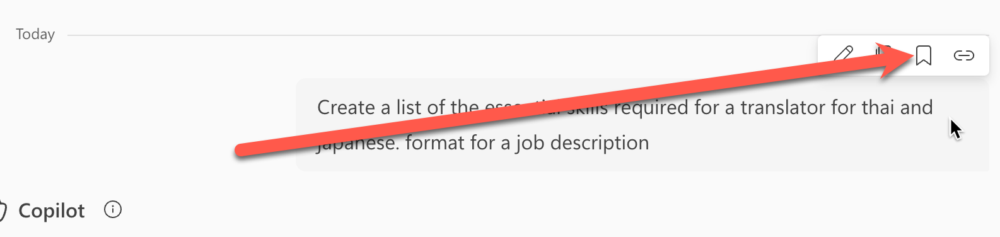
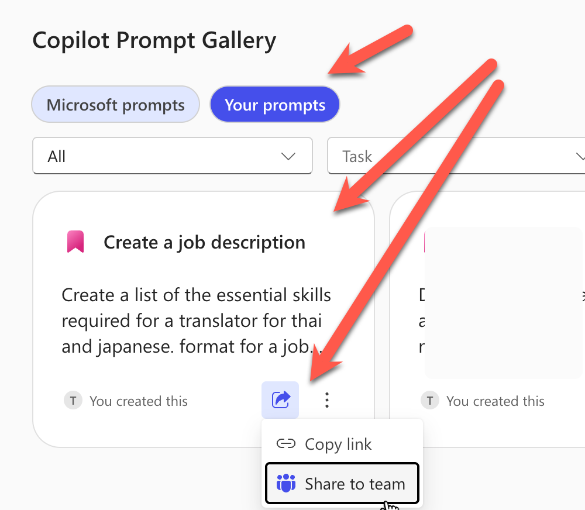

# Exercise: บันทึก Sales Prompt ไว้ใช้ซ้ำ

[กลับไปหน้า Workshop](../readme.md)

## Exercise Overview

เราจะเก็บ prompt ที่ทดลองและตรวจแล้วจากงาน Sales เพื่อกลับมาใช้กับงานครั้งต่อไป ใช้เวลาประมาณ 7 นาที ส่วนการแชร์เป็นกิจกรรมเพิ่มเติม

> **License:** เส้นทางหลักใช้ prompt ที่เรามีอยู่แล้ว ไม่ต้องเพิ่ม Microsoft 365 Copilot add-on license เพื่อเก็บเป็นข้อความ ส่วน **Prompt Gallery**, **Save prompt** และการแชร์ **ต้องตรวจสอบก่อนเริ่มอบรม** ตามบัญชีและ policy ขององค์กร

## Prerequisites

1. ลงชื่อเข้าใช้ [Microsoft 365 Copilot](https://m365copilot.com/) ด้วยบัญชีองค์กร
2. เปิด Chat จาก [งานสื่อสาร Sales](sales-communication.md) หรือ [Launch Readiness](copilot-in-action/new-product-launch-readiness.md) ที่ตรวจผลลัพธ์แล้ว

## Practice 1: บันทึกและเรียกใช้ Sales Prompt (7 นาที)

เราจะบันทึก prompt ที่ตรวจแล้วให้ค้นกลับมาใช้ได้ โดยยังคงเงื่อนไขไม่เติมข้อมูลเอง

#### Steps

1. เลือก prompt ที่ช่วยงานเราได้จริง 1 รายการจาก Chat เดิม เช่น Email ติดตามงาน หรือ Action Tracker
2. ถ้ามี **Save prompt** ใกล้ข้อความที่เราส่ง ให้เลือกปุ่มนี้

   

3. ตั้งชื่อที่ค้นง่าย เช่นชื่อด้านล่าง แล้วเลือก **Save**

   ```text
   Sales — ติดตามงานจากข้อมูลที่ตรวจแล้ว
   ```

4. เปิด **Prompt Gallery** แล้วหา prompt ใน **Your prompts** ตามตัวเลือกที่มีในบัญชี

   

5. เปิด prompt อีกครั้ง ตรวจว่าคำสั่ง รูปแบบ output และเงื่อนไขเรื่องข้อมูลที่ยังไม่ยืนยันอยู่ครบ ก่อนใช้กับข้อมูลชุดใหม่
6. เมื่อนำกลับมาใช้ ให้แนบหรือวางข้อมูลต้นทางชุดใหม่ก่อนทุกครั้ง เปลี่ยนรายละเอียดของงานเดิมให้ตรงกับงานใหม่ แล้วตรวจผลลัพธ์ใหม่ด้วย Prompt ที่บันทึกไว้ไม่ได้เก็บไฟล์หรือบริบทจาก Chat เดิมให้เรา

> **ถ้าไม่มีเมนูบันทึก:** คัดลอก prompt ไปเก็บในเอกสารหรือไฟล์ข้อความส่วนตัว ตั้งชื่อเดียวกัน แล้วเปิดกลับมาอ่าน 1 รอบ ไม่จำเป็นต้องรอเมนูนี้เพื่อทำกิจกรรมต่อ

#### Checkpoint

- เปิด prompt ที่เก็บไว้กลับมาได้ และยังมีคำสั่งให้ใช้เฉพาะข้อมูลที่ให้ พร้อมระบุ `[ต้องระบุ]` เมื่อข้อมูลไม่ครบ

## Practice 2: เตรียมแชร์ Prompt ให้ team (เพิ่มเติม)

เราจะตรวจทางเลือกการแชร์ prompt เฉพาะ team ที่ได้รับอนุญาต

#### Steps

1. ถ้ามี **Share prompt** ใน **Your prompts** ให้เปิดดู แล้วตรวจว่ามี **Share to team** หรือไม่
2. ตรวจชื่อ team และ policy ที่ใช้กับ workshop ก่อนดำเนินการ ไม่มี team หรือไม่แน่ใจสิทธิ์ ให้เก็บเป็น prompt ส่วนตัว
3. หากได้รับอนุญาตให้ทดลองแชร์ ให้ใช้เฉพาะ prompt สมมติที่ไม่มีข้อมูลลูกค้าหรือเนื้อหาภายใน แล้วตรวจรายการใน **Team prompts** ตามหน้าจอจริง

#### Checkpoint

- ระบุได้ว่าจะเก็บ prompt เป็นส่วนตัวหรือแชร์ใน team ใดตามสิทธิ์ โดยไม่ใส่ข้อมูลจริงใน prompt ที่แชร์

## Expected Output

- Sales prompt ที่บันทึกและเปิดกลับมาได้ 1 รายการ ผ่าน Prompt Gallery หรือเอกสารส่วนตัว

ลองนำ prompt นี้ไปใช้กับข้อมูลใหม่ โดยตรวจผลลัพธ์ทุกครั้งเหมือนเดิมนะครับ

[ต่อไป: จัดระเบียบผลลัพธ์ด้วย Copilot Pages](copilot-pages.md)

---

All rights reserved by [Amaround Co., Ltd.](https://www.nextflow.in.th/)

© 2026 Teerasej Jiraphatchandej. All rights reserved.

[Email me](mailto:teerasej@nextflow.in.th) · [Facebook](https://www.facebook.com/teerasej) · [YouTube](https://www.youtube.com/teerasej)
